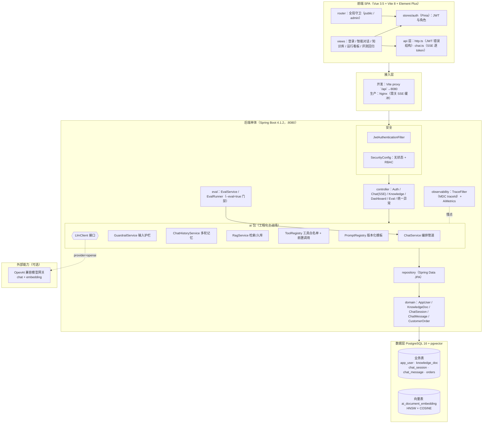
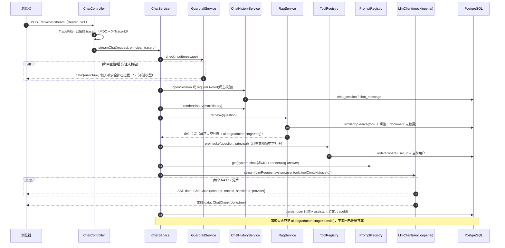
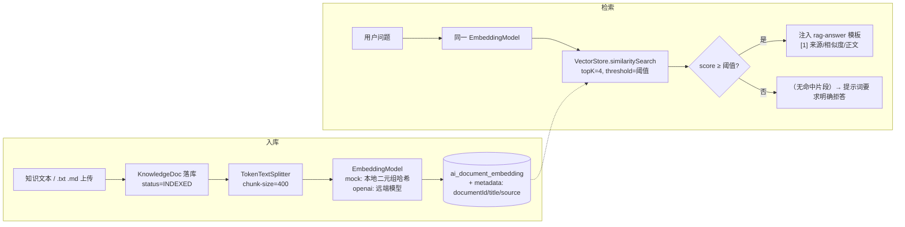
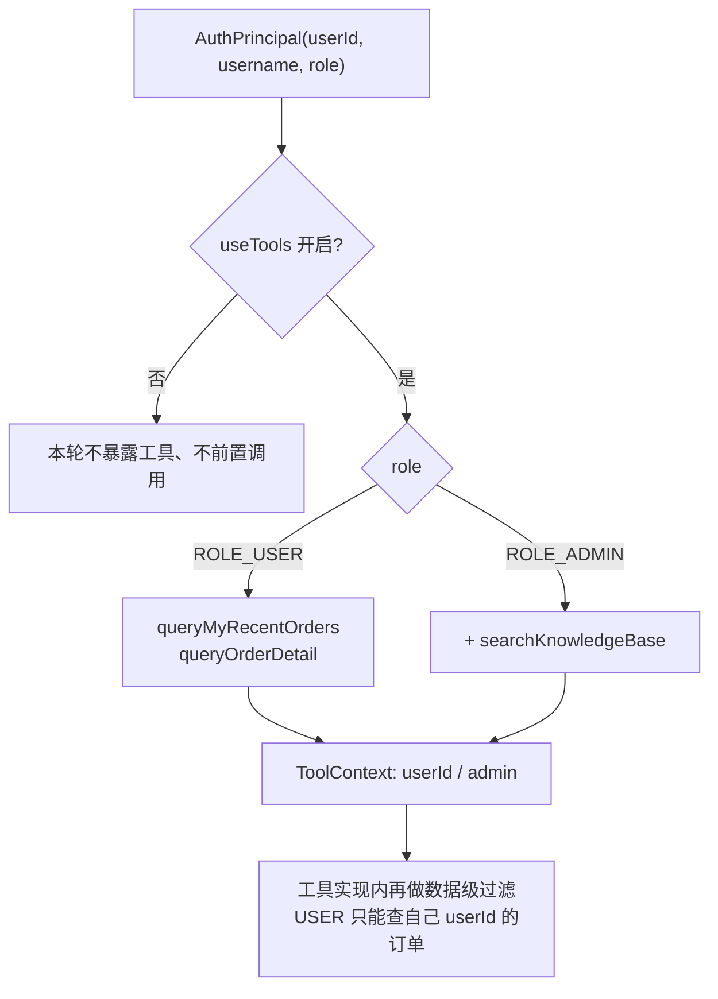
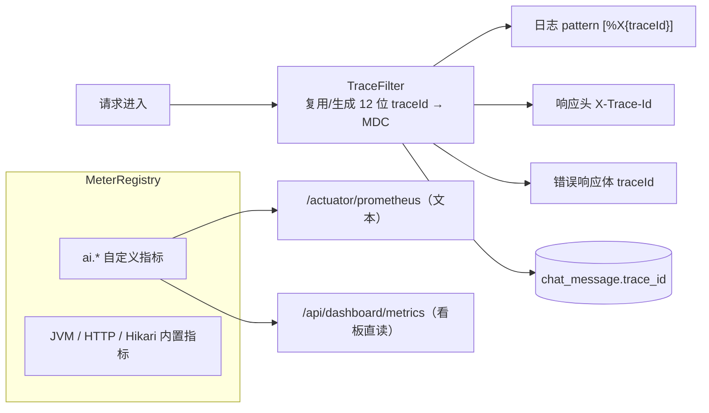
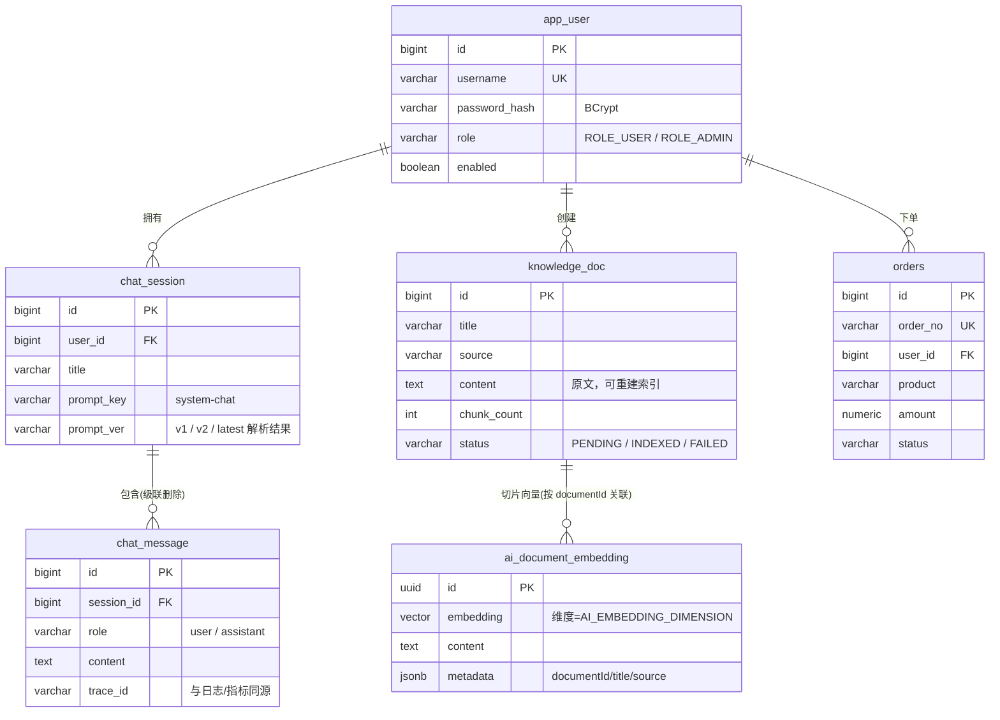
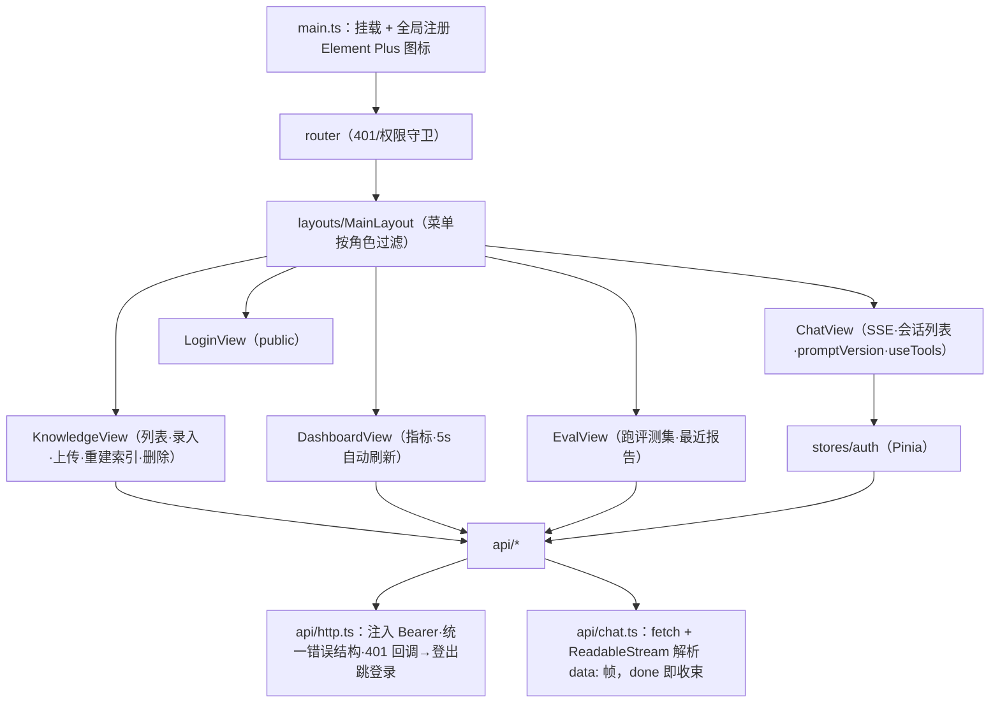
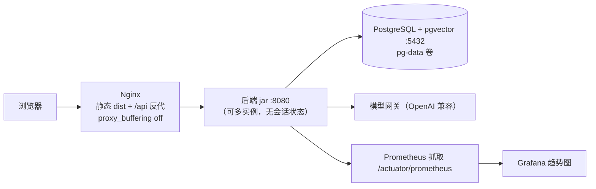

# 架构设计说明

> 对象：`ai-starter`（Spring Boot 4.1.2 + Spring AI 2.0.2 + Vue 3.5 + PostgreSQL/pgvector 16）
> 读者：接手二次开发的后端 / 全栈工程师
> 配套文档：[功能说明](FEATURES.md) · [部署文档](DEPLOYMENT.md) · [测试计划](TEST-PLAN.md)

---

## 1. 设计目标与约束

| 目标 | 落地方式 |
| --- | --- |
| 复用既有 Java 工程能力 | 纯 Java 单体：接口分层、JPA、Flyway、事务、Actuator 全是熟悉的东西，不引入 Python  sidecar |
| AI 能力可插拔 | 业务层只依赖 `LlmClient` 接口，`ai.provider` 一键切 mock / OpenAI 兼容网关 |
| 无 API Key 也能跑通全链路 | `MockLlmClient` + `MockEmbeddingModel`：护栏、RAG、工具、SSE、落库、指标、评测全部照常走 |
| 每个环节可观测、可降级 | 编排管道分段打点 `ai.*`；RAG 失败降级空上下文、LLM 失败返回兜底文案、落库失败不影响已推送答案 |
| 业务数据与向量同库 | PostgreSQL + pgvector，减少一致性问题的面 |
| 权限是硬约束 | JWT + RBAC，接口级 + 数据级（会话属主）+ 工具级（角色白名单）三层 |

**已知取舍**

- 单体而非「Java 网关 + Python AI 服务」：牺牲语言生态丰富度，换来部署链路、鉴权与事务的一致性。需要接 Python/Node 的算法服务时，把它做成一个 `@Tool` 工具即可，管道不变。
- 多轮记忆落业务库而非 Spring AI `ChatMemory`：换来可审计、可按 `traceId` 串联、进程重启不丢。代价是要自己控制携带条数（`ai.max-history`）。
- Prompt 存 classpath 文件（文件名即版本）而非数据库：换来 git 可审、发布即回滚。灰度需求（按流量比例切版本）需要另建 `prompt_version` 表 + 分配策略。

---

## 2. 总体分层

**依赖方向**：`controller → ai → repository → domain`。`ai` 不依赖任何 Web 类型（除 SSE 用的 `Flux`）；`LlmClient` 是唯一的模型抽象边界，切 Provider / 加路由（多模型按任务分派）都只改 `config/AiConfig`。

---

## 3. 一次对话请求的完整时序

**关键点**

1. 护栏在最前面：被拦截的输入不产生任何模型调用与 token 成本。
2. `Flux.defer(...)`：订阅时才执行编排，保证异常能走响应式 `onErrorResume`，SSE 语义不被破坏。
3. 工具两层：服务端「关键词前置调用」保证链路稳定（Mock 也能演示），`@Tool` 原生 function calling 让真实模型自主补充。
4. `done` 帧是前端的结束信号——不必等连接关闭（Vite/keep-alive 下连接可能延迟断开）。
5. 错误不毁流：护栏命中、会话不存在、越权访问、模型超时均回一帧 `error:true` 的可读错误，HTTP 仍为 200（`streamChat` 外层两级 `onErrorResume`）。

---

## 4. RAG 数据流

| 设计点 | 说明 |
| --- | --- |
| 双阈值 | `ai.rag.min-score=0.65`（语义向量）/ `ai.rag.mock-min-score=0.12`（Mock 的字面重合度量级低）。`RagService#threshold()` 按 `llmClient.provider()` 选择 |
| 重新入库 = 先删后写 | `deleteByDocumentId` 用 `Filter.Expression` 按 `documentId` 清旧向量，避免同文档重复片段污染召回 |
| 检索异常不阻断 | `catch` → 空上下文 + `ai.degradation{stage=rag}`，答案走「未找到相关信息」，宁可拒答不可编造 |
| 换 embedding 模型 | 向量维度与来源分布都变，必须重建向量表并「重建索引」（见部署文档 §6） |

---

## 5. 工具调用与权限

三条独立的权限关卡（缺一层都可能被绕过）：

| 关卡 | 位置 | 拦截效果 |
| --- | --- | --- |
| 接口级 | `SecurityConfig`（`hasRole/hasAnyRole` + `dispatcherTypeMatchers(ASYNC, ERROR).permitAll()`） | USER 调知识库写接口 / 评测 / 看板 → 403 |
| 数据级 | `ChatHistoryService#requireOwned`、`OrderQueryTool` 内 `userId` 过滤 | 换 sessionId 读别人会话 → 越权异常 |
| 工具级 | `ToolRegistry#toolsFor/toolNames` 按角色白名单 | 模型侧拿不到超出角色的能力 |

意图路由：`ORDER_INTENT = (订单|我的.{0,4}单|order|发货|退款|物流|花了多少|金额)`，命中才 `preInvoke`，避免每轮无谓打库。

---

## 6. 可观测架构

| 指标 | 类型 | tag | 用途 / 告警建议 |
| --- | --- | --- | --- |
| `ai.llm.latency` | Timer | type(complete/stream)、provider、success | 模型耗时；stream 的总量≈尾包时间，`max` 看长尾 |
| `ai.llm.calls` | Counter | type、provider、success | 成功率 = success:true / 总数，掉到 99% 以下告警 |
| `ai.llm.tokens` | Counter | provider、kind(prompt/completion) | 成本口径（Mock 为估算值，不做计费依据） |
| `ai.rag.latency` | Timer | — | 检索耗时 |
| `ai.rag.contexts` | Summary | — | 平均/最大命中片段数；均值趋 0 = 知识覆盖不足或阈值过高 |
| `ai.tool.calls` | Counter | tool、success | 工具用量与失败率 |
| `ai.guardrail.blocked` | Counter | reason(EMPTY/TOO_LONG/INJECTION) | 攻击与异常输入观测 |
| `ai.degradation` | Counter | stage(rag/llm/persist/prepare) | 任一 stage 突增即降级发生，优先看 llm；prepare 集中在会话不存在 / 越权 |

注册名与实现见 `observability/AiMetrics.java`，`application` tag 由 `management.metrics.tags` 统一附加。

---

## 7. 数据模型

- 业务表由 **Flyway** `V1__init_schema.sql` 建（`CREATE EXTENSION vector` 在最前）；向量表由 `spring.ai.vectorstore.pgvector.initialize-schema=true` 自动建。
- JPA 是 `ddl-auto: validate`：**任何实体字段变更都要配一个新的迁移脚本**，别改成 `update`。
- `@Lob` 在 Hibernate 7 + PG 下会映射成 large object（`oid`）与 `TEXT` 列冲突 → 正文字段一律纯 `@Column`。

---

## 8. 前端架构

- **令牌存储**：`localStorage`（`ai-starter-token` / `ai-starter-user`），刷新续期；真正的鉴权在后端，前端路由守卫只是体验层。
- **SSE 不用 EventSource**：对话需要 POST body + `Authorization` 头，故用 `fetch` + `ReadableStream` 手工按 `\n\n` 分帧。
- **401 单向解耦**：`http.ts` 只暴露 `setUnauthorizedHandler`，由 `router/index.ts` 注册「清身份 + 跳登录并带 redirect」。

---

## 9. 部署拓扑

无状态：JWT + 会话落库 ⇒ 后端可水平扩容，不需要会话粘滞；只需注意**并发实例的向量重建索引别同时跑**（按 `documentId` 删写，非幂等）。

---

## 10. 包与扩展点速查

| 包 | 职责 | 常见改法 |
| --- | --- | --- |
| `config/AiConfig` | Provider 装配（mock/openai + mock Embedding `@Primary`） | 加 `provider=azure/ollama` 分支：新增一个 `LlmClient` bean + 一个 `@ConditionalOnProperty` |
| `ai/ChatService` | 编排管道 | 加配额/限流在 `prepare` 前；加输出侧护栏在 `persist` 前后（`GuardrailService` 预留 `checkOutput`） |
| `ai/PromptRegistry` | `classpath:prompts/name.vN.md` | 新增版本即加文件，不改代码；DB 化需替换本类 |
| `ai/RagService` | 只依赖 `VectorStore` | 换 milvus/ES：换 starter + 配置，代码不变 |
| `ai/tool/*` | `@Tool`/`@ToolParam` | 加工具：`@Component` + 注册进 `ToolRegistry` 角色白名单 |
| `observability` | TraceFilter + AiMetrics | 加维度（tenant/scenario）在 `AiMetrics` 的 tag 上动 |
| `eval` | 回归集与门禁 | 加用例即改 `eval-cases.json`；接入 CI 见测试计划 §7 |
| `bootstrap/DataSeeder` | 演示账号/订单/知识文档 | 生产用环境变量开关（建议 `ai.seed.enabled=false`） |
